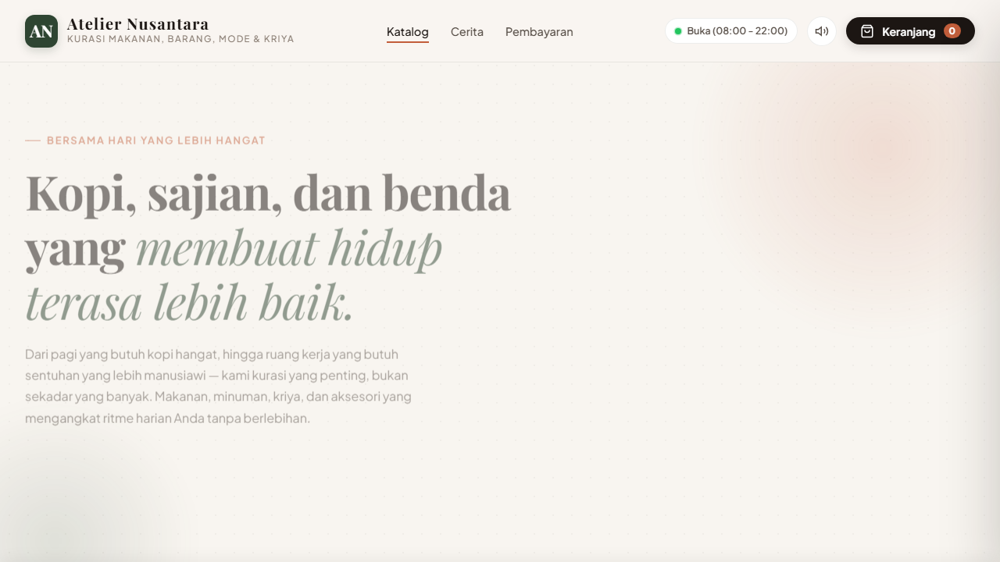

# Atelier Nusantara

Atelier Nusantara adalah storefront commerce statis dengan rasa editorial untuk kurasi makanan, minuman, kriya, fashion, gadget, dan produk digital. Proyek ini dibuat untuk pengalaman belanja yang tenang, jelas, dan tetap praktis di layar desktop maupun ponsel.



## Yang tersedia

- Katalog multi-kategori dengan pencarian, filter, sorting, quick view, dan varian produk.
- Keranjang belanja, checkout, ringkasan pesanan, struk, dan pelacak status pesanan.
- QRIS dengan parser EMVCo dan generator payload nominal.
- Panel admin full-viewport untuk pesanan, katalog, stok, storefront, pembayaran, dan tools.
- Edit produk, tambah produk, hapus produk, serta kontrol status tersedia atau habis.
- Sinkronisasi perubahan antar-tab memakai `BroadcastChannel` dengan fallback event `storage`.
- GSAP dan ScrollTrigger untuk motion yang terarah, dengan fallback reduced motion.
- PWA manifest dan service worker untuk cache aset lokal.

## Menjalankan secara lokal

Proyek ini tidak memakai `package.json`. Jalankan server HTTP sederhana dari folder proyek:

```cmd
cd /d "C:\Users\USER\Downloads\WEBSITE\TEST-PAYMENT"
python -m http.server 5500
```

Buka [http://localhost:5500/index.html](http://localhost:5500/index.html).

Jangan membuka `index.html` langsung dengan `file://`, karena module JavaScript, service worker, dan beberapa fitur browser membutuhkan HTTP server.

## Membuka admin

Gunakan URL berikut:

```text
http://localhost:5500/index.html?admin=1
```

Kredensial demo saat ini:

- Username: `admin`
- Password: `atelier2026`

Kredensial tersebut tertanam di frontend dan hanya cocok untuk demo lokal. Jangan memakai konfigurasi ini untuk toko publik tanpa backend, autentikasi server, dan penyimpanan rahasia yang benar.

## QRIS dan pembayaran

Implementasi QRIS di repository ini berjalan di browser. Sistem dapat:

1. Membaca payload QRIS EMVCo yang valid.
2. Mengubah QRIS statis menjadi payload dengan nominal dinamis.
3. Menghasilkan ulang CRC16 dan merender QR code.
4. Menampilkan alur pembayaran dan konfirmasi pesanan.

QRIS dinamis yang benar-benar memverifikasi settlement tetap membutuhkan koneksi ke provider pembayaran atau backend merchant. Gambar QRIS saja tidak menjamin transaksi dapat dikonversi atau diverifikasi otomatis.

## Batas realtime

Realtime yang tersedia adalah realtime antar-tab pada browser dan perangkat yang sama. Data operasional disimpan di `localStorage`, sehingga:

- tab lain dapat menerima perubahan katalog, storefront, dan pesanan;
- perangkat lain tidak otomatis menerima perubahan;
- data dapat hilang jika storage browser dibersihkan;
- aplikasi belum menyediakan otorisasi multi-user atau audit log server.

Untuk produksi, gunakan backend dan database dengan autentikasi, validasi server, webhook pembayaran, serta kontrol akses admin.

## Struktur proyek

```text
index.html                 Halaman storefront dan shell admin
styles/main.css            Design system dan responsive layout
scripts/app.js             State, katalog, checkout, admin, dan realtime browser
scripts/qris.js            Parser dan generator QRIS EMVCo
scripts/vendor/            GSAP, ScrollTrigger, QR decoder, dan QR renderer
sw.js                      Service worker cache
manifest.json              Konfigurasi PWA
DESIGN.md                  Arah visual dan motion
qris/                      Aset QRIS lokal
```

## Arah desain

Atelier Nusantara memakai pendekatan **Editorial Commerce**: warna parchment, matcha, dan terracotta; tipografi display yang hangat; serta motion yang membantu orientasi tanpa mengambil alih konten. Detail keputusan visual tersedia di [DESIGN.md](DESIGN.md).

## Lisensi

Proyek ini dirilis di bawah [MIT License](LICENSE).

## Kontak dan kontribusi

Perubahan yang memperbaiki aksesibilitas, ketahanan state, dokumentasi, dan pemisahan yang jelas antara demo frontend dan layanan produksi sangat diterima. Untuk perubahan besar, jelaskan masalah yang diselesaikan dan dampaknya pada alur storefront sebelum membuka pull request.
